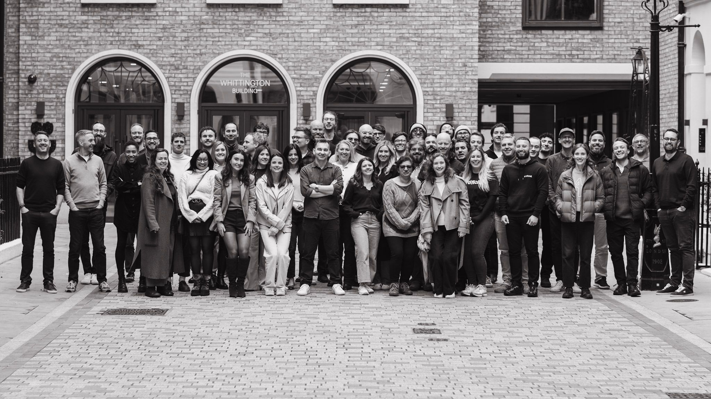

# London Haskell

{class=center}

:::notes
berlin code of conduct: https://berlincodeofconduct.org/en
:::

---

{.horizontally-centered .padded width=55%}

{.horizontally-centered width=80%}

:::notes
:::

---

# Working at Artificial

We may be interested in hiring experienced Haskell programmers.

Please send your details to the following email (base64).

(Mention that you were pointed here by Ben Orchard at the London Haskell October meetup hosted at Artificial.)

```
ZGF2 ZS5i b3ls ZXNl a2Vy YSAo YXQp
IGFy dGlm aWNp YWwg KGRv dCkg aW8K
```

---

# Join the Discord

[QR_CODE_HERE](https://discord.gg/ABy7Hy2z8k){.qrcode .horizontally-centered}

:::notes
:::

--- 

# We Want You To Talk

[QR_CODE_HERE](https://docs.google.com/forms/d/e/1FAIpQLSdooVoZbGVjCuPHgmBwRG-l6JjmsUyjawNroVpt8t9Y-x_pkw/viewform){.qrcode .horizontally-centered width=300px height=300px}

:::notes
:::

---

# London Haskell 
## November TBC @ TBC

[QR_CODE_HERE](https://example.com){.qrcode .float-right}

* TBC
  * TBC
* TBC

:::notes
:::


